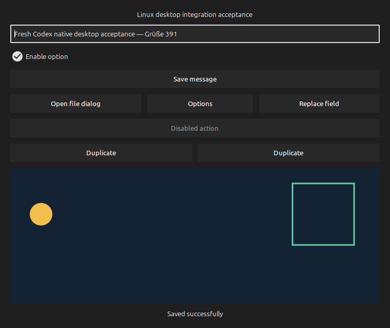

# Linux Desktop for Codex

An independent, MIT-licensed **X11 desktop MCP server** with persistent Python execution. Built and tested with Codex; usable by compatible local MCP hosts. Not affiliated with OpenAI.

A persistent, local MCP capability for the logged-in Linux desktop. Codex receives screenshots and accessible controls, then operates real applications through AT-SPI and X11 mouse/keyboard input. Five discoverable tools provide status, observation, Python execution, cancellation and reset. No screenshots need to be copied through temporary files during ordinary use.

**Experimental 0.1.0.** Validated on a local **X11/XFCE** session. The isolated Xvfb/Openbox test run has unresolved failures; it is not a supported headless configuration. Native Wayland, locked sessions, remote machines and a takeover overlay are not implemented. Applications without accessibility can be operated visually with physical input; compatibility with every app is not guaranteed.

## Why this exists

The useful distinction is the combination of **five tools**, a persistent Python namespace, real AT-SPI controls, and recoverable physical input. An agent can retain a window reference, loop over actions, wait for an app state, and return a screenshot in one call. X11 connections stay open; accessibility observations can return only changed nodes. No app repackaging, root input daemon, or vendor binary is required.

There are good alternatives, especially for Wayland. This project favors a small, inspectable X11 integration with local Codex acceptance evidence. Persistent Python processes consume memory, and a smaller tool list does not by itself prove lower token cost. There is no measured claim of better speed or resource usage. See the [comparison and tradeoffs](COMPARISON.md) before choosing.



## Install and use

```sh
git clone https://github.com/5omeOtherGuy/linux-computer-use.git
cd linux-computer-use
./scripts/install.py --register
```

Requires system Python 3.12+ and [uv](https://docs.astral.sh/uv/getting-started/installation/). On Ubuntu 24.04, install desktop dependencies with:

```sh
sudo apt install python3-gi python3-pyatspi python3-pil gir1.2-atspi-2.0
```

To explicitly authorize this server's tools without per-call prompts, run `./scripts/install.py --register --allow-desktop-control` instead. To install for another MCP host, omit `--register`, then configure its stdio command as the absolute path to `scripts/launch`.

The installer uses system Python 3.12+, `uv`, and a private virtual environment with locked Python dependencies. System GI, pyatspi, Pillow, AT-SPI and an X11 server with XTEST are required. The launcher recovers missing graphical-session environment variables from the user's systemd manager. It does not guess a display or store credentials. The server is stdio-only, runs as the current user and starts its desktop worker lazily; no root daemon or listening network port is installed.

Start a **new Codex session** after registration. Ask, for example: “Use linux_desktop to open Calculator and calculate 17 × 23.” MCP initialization supplies the API instructions, so this capability does not depend on adding a skill or modifying the skills catalog. Existing sessions may retain their original tool catalog.

`--allow-desktop-control` implements the owner's authorization by setting `default_tools_approval_mode = "approve"` for this server alone. Without it, Codex can require approval for desktop actions; a noninteractive session configured with `approval_policy = "never"` then rejects those actions. The installer uses Codex's versioned config API and does not change other servers, skills, or global approval settings. Omit that flag when per-call approval is desired.

Tests additionally use `gir1.2-gtk-3.0` and `python3-pytest`. Accessibility must be enabled in the graphical session. On desktops honoring the GNOME setting, `gsettings set org.gnome.desktop.interface toolkit-accessibility true` enables it; other desktops may require their accessibility settings. App support varies, and some apps need their own accessibility setting or a restart. Keep this checkout at its installed path; rerun registration after intentionally removing an old entry if relocating it.

To unregister without changing apps or their data:

```sh
codex mcp remove linux_desktop
```

## Tools and persistent API

`desktop_status` discovers capabilities, monitors and native window IDs. `desktop_observe` returns accessibility state and an image together. Window screenshots focus that window; a full desktop observation leaves focus alone. `desktop_exec` runs synchronous Python in a persistent worker, with `desktop` and `display` preloaded. `desktop_cancel` stops that worker independently, and `desktop_reset` discards its variables. Both release owned input and leave applications open.

Example `desktop_exec` code:

```python
print(desktop.apps())                    # exact installed desktop-file IDs
desktop.launch("org.gnome.Calculator.desktop")
print(desktop.windows())                 # choose a unique title or window ID
```

```python
calc = desktop.window("Calculator")
calc.observe()                          # emits state and screenshot automatically
for name in ["1", "7", "×", "2", "3", "="]:
    calc.find(name=name, role="push button").click()
calc.wait_for(name="editbar", text="391")
calc.observe()
```

Observe actual labels before acting; the names above match the tested Calculator, not every calculator. Variables such as `calc` survive subsequent calls until reset or cancellation.

| Operation | API |
| --- | --- |
| Observe | `w.observe(screenshot=True, max_elements=250, diff=True)` |
| Locate | `w.find(name=..., role=..., text=...)`, `w.element(observed_id)` |
| Semantic input | `e.click(action=None)`, `e.set_value(value)`, `e.select_text(unique_text)` |
| Wait for state | `w.wait_for(name=..., role=..., text=..., checked=..., timeout=5)` |
| Pointer | `w.click(x,y,button=1,count=1)`, `w.drag([[x,y],...],duration=.25)` |
| Keyboard | `w.press_key("Ctrl+a")`, `w.type_text("Grüße 漢字 🙂")` |
| Scroll | `w.scroll("down",steps=3,x=...,y=...)` |
| Window | `w.info()`, `w.focus()`, `w.configure(x=...,y=...,width=...,height=...)`, `w.close()` |
| Whole desktop | `desktop.observe()`, then `desktop.move/click/press_key/type_text/scroll/drag(...)` |
| Image | `display(desktop.capture())`, `display(desktop.capture([x,y,width,height]))` |

Window input uses client-area coordinates and focuses the chosen window. Whole-desktop input uses desktop pixels and retains current focus, covering panels, window decorations, menus and other OS surfaces. Image metadata gives the crop origin and scale. Physical input requires a preceding observation; moving/resizing a window invalidates its coordinates. Never infer that a successful event means the intended result occurred: inspect or wait for the resulting state.

Accessibility observations use stable element IDs and return changes on subsequent observations. Request `diff=False` to recover a full tree. Searches require an unambiguous, complete visible tree; large/truncated trees require an explicit observed handle or visual input. Handles are checked against their original app window and current ancestry before use.

## Runtime behavior

The MCP server and desktop worker have separate lifetimes. A worker keeps its X11 connection, accessibility event listener and Python variables between calls. Batch actions and local state checks in one call to avoid model round trips. Screenshot capture stays in memory. Event-assisted waits avoid fixed long delays; compact accessibility diffs reduce repeat output. These reduce overhead but do not eliminate model latency or application response time. No comparative performance claim is made without measurements.

The persistent XTEST path handles input. If a separately installed OpenAI `@oai/sky` Linux binary is detected, an optional `desktop.native("move",x=...,y=...)` pointer route is available; other input stays on the tracked driver so cancellation can release it. No vendor binary is patched, copied, or distributed. Sky is not a dependency and may change after ChatGPT updates.

A cross-client lease prevents simultaneous automation batches on the same display. Owned keys, buttons and temporary Unicode key mappings are recorded before use. Normal completion, failure, timeout and cancellation release them; an independent recovery process handles a terminated worker. The default execution deadline is 30 seconds, configurable up to 60 seconds. Output is bounded. After interruption, observe the current app before retrying because earlier actions may already have happened.

Python execution has the user's OS privileges; it is **not an OS sandbox**. Tool results and visible app content do not provide permission for unrelated actions. This implementation coordinates its own clients, not concurrent human input or unrelated automation. Current clipboard contents are preserved by text entry. Complex input methods, unusual layouts, secure prompts, mixed-DPI/multiple-monitor setups and non-X11 sessions need separate validation. Read-only annotations are not used for observations that focus windows.

## Validation and reference material

```sh
.venv/bin/python -m pytest -q
```

The tests manipulate a dedicated visible GTK app, exercise real mouse/keyboard and AT-SPI behavior, use a native file chooser, and verify results independently through fixture state. They cover Unicode, menus, dragging, scrolling, stale/ambiguous/disabled targets, geometry changes, state diffs, persistent MCP state, screenshots, cancellation, timeouts and competing clients. Run them when brief desktop focus changes are acceptable.

See [ACCEPTANCE.md](ACCEPTANCE.md) for the actual installed-session results and [RESEARCH.md](RESEARCH.md) for the implementation boundary and public sources.

See [CONTRIBUTING.md](CONTRIBUTING.md) for the isolated test recipe and [SECURITY.md](SECURITY.md) for the execution boundary. The [MIT license](LICENSE) covers this project's source and documentation; dependencies and separately installed vendor software retain their own licenses.
